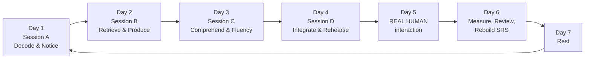
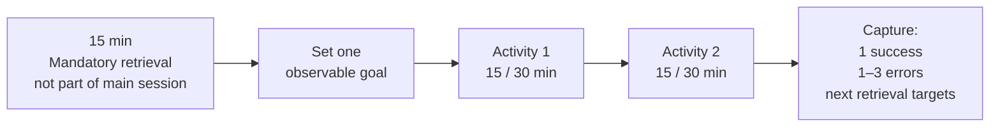
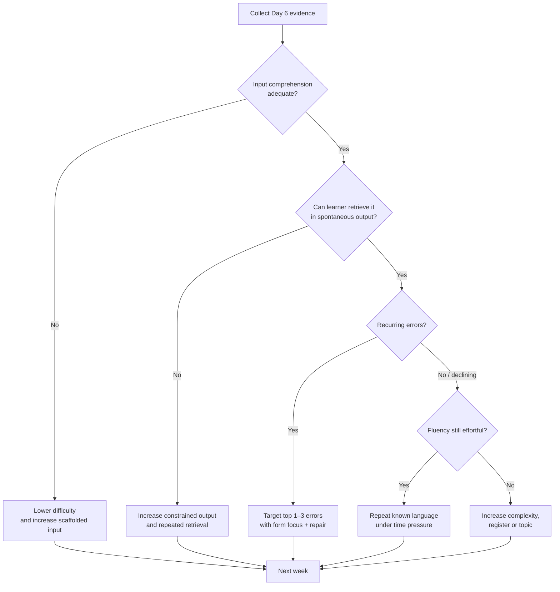

# Evidence-Based Blueprint for a Spanish-Speaking Adult Learning French, Portuguese, Italian, or English

## Executive summary

The strongest evidence does **not** support a single “magic method.” The optimal strategy is a **repeating weekly system** that deliberately cycles through meaning-focused input, meaning-focused output, language-focused learning, and fluency development—the four strands associated with Paul Nation—while progressively transferring control from external supports to the learner. Nation’s model proposes roughly balanced attention to the four strands across a course; that balance is best treated as a **weekly/curricular target rather than a requirement to divide every individual session into four equal quarters**. citeturn0search12

For an adult native speaker of Spanish, the optimal design is therefore:

**daily retrieval → two deliberately chosen learning activities → measurable output → error capture → spaced reactivation → weekly real-human interaction → weekly evaluation.**

This recommendation is consistent with several converging literatures. Extensive reading has positive effects across L2 outcomes; explicit pronunciation instruction is effective; computer-assisted pronunciation training has a meaningful average effect; classroom oral corrective feedback facilitates L2 development; and a 2024 meta-analysis of 49 AI-language-learning studies found positive overall effects, particularly for listening and speaking, although those studies involved heterogeneous technologies and therefore do **not** prove that any particular chatbot or app is independently superior. citeturn15search11turn17search3turn18search16turn14search0turn18search9

The strategic implication is important:

> **Use AI to multiply repetitions, personalization, feedback opportunities, and low-stakes speaking—not to replace retrieval, productive struggle, native models, or real people.**

Current ChatGPT Voice supports free-form spoken interaction and can therefore function effectively as an always-available role-play partner, but OpenAI itself warns that voice systems can make mistakes; OpenAI has also noted that speech systems can display non-native accents or uneven performance in some languages. AI audio should consequently be a **practice partner, not the sole pronunciation authority**. citeturn4search9turn4search23

The same principle applies to writing corrections. The learner should **attempt first, request feedback second, repair third, and retrieve the repaired form later**. Asking AI to generate polished answers before the learner has attempted the task is pedagogically much weaker because it removes precisely the retrieval and noticing work that the learner needs to perform.

For Spanish speakers, transfer should be treated as both an accelerator and a source of error. French, Portuguese, and Italian allow unusually rapid progress in reading, vocabulary inference, morphology, and basic syntax because of Romance-language overlap. But this creates the danger of **false fluency**: comprehension on the page can greatly outrun phonological decoding and spontaneous production. Published “lexical similarity” percentages are sometimes quoted as if they were percentages of automatically usable cognates; they are not equivalent measures, so a claim such as “50–85% of vocabulary is cognate” should not be used as a curriculum formula. citeturn5search3

English offers less wholesale grammatical transfer, but Spanish speakers can exploit the very large stratum of Latinate and Greek-derived learned vocabulary. The main bottlenecks shift toward sound–spelling relations, reduced vowels, stress, consonant clusters, high-frequency Germanic vocabulary, multiword verbs, and syntactic patterns that cannot safely be translated word-for-word.

The four autonomy levels should therefore differ less in *whether* they contain input, output, focus, and fluency than in **how much scaffolding each strand receives**:

| Level | Main cognitive problem | Strategic priority | AI role | Human-interaction role |
|---|---|---|---|---|
| **Level 1 — Foundational** | L2 is poorly segmented; heavy dependence on translation | Build sound-to-meaning mappings, chunks, core patterns | Slow, constrain, drill, simulate | Make first spontaneous exchanges psychologically safe |
| **Level 2 — Operational** | Translation bottleneck; native speech still too fast | Convert knowledge into automatic comprehension and conversation | Role-play, transcript diagnosis, reformulation | Sustain conversations and negotiate meaning |
| **Level 3 — Expansion** | Fluent but repetitive; fossilized errors | Expand lexical/syntactic range and repair accuracy | Challenge, analyze, generate counterexamples | Debate, narrate, persuade, receive selective correction |
| **Level 4 — Refinement** | Accent, prosody, register, pragmatics | Fine phonetic/prosodic control and sociolinguistic choice | Simulation and forensic feedback | Native-speaker judgment becomes especially valuable |

The proposed calendar is fixed around the requested structure. The four self-study days each begin with a **mandatory 15-minute review that is not counted inside the 30/60-minute main session**. Day 5 belongs to genuine human communication. Day 6 measures performance, reorganizes the SRS and error log, and chooses the next week’s priorities. Day 7 is genuinely off.

At the minimum dose this architecture represents approximately **four hours of planned learning per week** if Days 5 and 6 are also 30 minutes; at the optimal dose it represents approximately **seven hours per week** if Days 5 and 6 are 60 minutes. The week estimates below are therefore **planning blocks, not scientifically guaranteed “time-to-fluency” claims**. Progression should be determined by exit metrics rather than by the calendar.

## Evidence base, learning architecture, and transfer from Spanish

Nation’s four strands provide the organizing framework, but several additions make it suitable for an autonomous adult learner. Meaning-focused input creates encounters with language in communication; meaning-focused output requires retrieval and message construction; language-focused learning allows deliberate work on grammar, vocabulary and phonology; fluency development makes already-known material faster and less effortful. Nation’s framework argues for substantial opportunity in all four, rather than a course dominated by grammar explanation or passive exposure. citeturn0search12

This matters because popular language-learning arguments often create false dichotomies: “input versus output,” “grammar versus acquisition,” “flashcards versus immersion,” or “AI versus people.” An evidence-informed program uses each where it solves a different bottleneck.

**Input should be understandable enough that attention can remain primarily on meaning.** Extensive reading is one well-supported implementation: Nakanishi’s meta-analysis found an overall benefit of extensive reading across L2 studies. The practical equivalent for listening is not “listen to incomprehensible native speech until it becomes comprehensible,” but rather to manipulate difficulty through topic familiarity, transcripts, L2 captions, replay, shorter clips, and repeated listening. citeturn15search11

**Output should create retrieval pressure, not simply display rehearsed knowledge.** The learner needs opportunities to discover, “I know what I mean, but I cannot yet say it.” Corrective feedback then becomes useful because the gap is psychologically salient. Lyster and Saito’s meta-analysis of classroom oral corrective feedback supports a genuine learning role for feedback rather than the idea that all correction necessarily interrupts acquisition. citeturn14search0

**Explicit language focus is valuable when it is narrow and immediately operationalized.** A ten-minute explanation of French object pronouns followed by comprehension and production is more useful in this architecture than forty minutes of abstract parsing without communicative reuse. Pronunciation deserves explicit treatment particularly early, because L1 sound categories otherwise encourage systematic substitution. A meta-analysis of L2 pronunciation instruction found pronunciation teaching effective, and a 2024 meta-analysis of 31 computer-assisted pronunciation studies found an overall medium effect, while also showing that outcomes vary by setting and tool. citeturn17search3turn18search16

**Fluency practice uses mostly known language.** It is not the place to maximize novelty. Repeated retelling, shadowing of already-understood material, timed speaking, repeated reading, and fast retrieval are therefore best used after accuracy and meaning have been established. “Shadowing” is useful here as a short controlled technique, but it should not be promoted as a complete acquisition method.

A useful synthesis of popular autodidact/polyglot techniques is therefore:

| Popular technique | Evidence-based interpretation | Keep, modify, or reject? |
|---|---|---|
| Massive comprehensible input | Large amounts of meaning-focused exposure | **Keep**, but combine with output and form work |
| Sentence mining | Collecting personally encountered lexical/grammatical chunks | **Keep**, but mine selectively rather than hoarding cards |
| SRS | Spaced retrieval of high-value material | **Keep**, but prevent reviews from displacing communication |
| Shadowing | Repeated phonological rehearsal of understood material | **Keep as fluency/pronunciation practice**, not as the curriculum |
| “Speak from day one” | Early retrieval and tolerance of communicative uncertainty | **Keep**, but use constrained tasks at Level 1 |
| “Never translate” | Attempt to force direct L2 processing | **Reject at Level 1 as an absolute**; progressively reduce translation |
| “Never study grammar” | Reaction against grammar-heavy instruction | **Reject**; brief form-focused intervention has a legitimate role |
| “AI tutor instead of teachers/partners” | Unlimited low-stakes interaction | **Reject as replacement; keep as supplement** |
| Memorize isolated word lists | Fast lexical exposure | **Modify** into high-frequency chunks plus contextual retrieval |

### The transfer advantage from Spanish

The correct principle is **contrastive exploitation**, not “pretend the learner has no L1.”

For French, Portuguese, and Italian, the learner should actively search for correspondences in vocabulary, derivational morphology and sentence structure. A Spanish speaker can often infer written Romance vocabulary far sooner than an unrelated-language learner. But high similarity produces two characteristic dangers: accepting false friends without verification and silently pronouncing the L2 through Spanish phonology.

The rule from Week 1 should therefore be:

> **Trust a transparent Romance cognate provisionally for meaning; never assume its pronunciation or usage is identical.**

Every mined cognate should be mentally tagged as one of three types:

**safe transfer** — same or very close meaning and distribution;  
**conditional transfer** — useful but with pronunciation, collocational, grammatical or register differences;  
**dangerous transfer** — false or misleading friend.

Do not build the curriculum around a supposedly exact percentage of common vocabulary. Lexical-similarity calculations and learner-usable cognates are methodologically different things. citeturn5search3

For English, the transfer strategy is different. Latinate vocabulary becomes particularly valuable in formal, academic and professional registers—compare *important/importante, possible/posible, information/información, determine/determinar*—but the learner must not infer that high-frequency everyday English behaves like Romance vocabulary. English commonly expresses everyday meanings through Germanic verbs and multiword constructions, so the learner should acquire **chunks such as “figure out,” “pick up,” “work out,” “turn down” and “run out of” as lexical units**, not by independently translating the verb and particle.

A Spanish speaker also needs an explicit **anti-transfer phonological map** early. The objective is not to master the IPA before communicating; it is to identify those contrasts that Spanish normally collapses and that can affect intelligibility. The same logic applies to French front-rounded and nasal vowels, Portuguese nasal/open–closed vowel contrasts, Italian consonant length, and the larger English vowel inventory. Explicit pronunciation instruction and computer-assisted practice are supported at the mechanism level, although the effectiveness of a particular commercial app cannot be inferred automatically from the meta-analytic results. citeturn17search3turn18search16

### The mandatory fifteen-minute retrieval block

Every self-study day begins identically. This is outside the 30/60-minute main session.

| Minutes | Task | Rule |
|---|---|---|
| **0–5** | **Blank retrieval:** without notes, reconstruct yesterday’s 5–10 target chunks, one grammar pattern and one pronunciation target | Retrieval **before** rereading |
| **5–10** | **SRS due cards:** Anki/FSRS or paper cards | Do due cards before adding new ones |
| **10–15** | **Error repair:** reproduce three corrected sentences from yesterday without looking, then compare | Failed repair returns to the week’s error log |

Anki’s current scheduler and statistics allow learners to monitor retrieval and retention, while its “leech” mechanism identifies repeatedly failing cards. The correct response to a leech is usually to **rewrite, contextualize, split, or suspend the card**, rather than to keep failing the same badly designed prompt indefinitely. citeturn11search3turn11search0turn11search21

## Digital and AI tool matrix, weekly cycle, and operating rules

The 2024 meta-analysis of AI-assisted L2 learning synthesized 49 studies and 79 reports and found an overall positive effect, with particularly promising results for listening and speaking. Crucially, the interventions varied greatly in technology, setting, duration and feedback source. The correct inference is therefore “AI can be educationally useful under well-designed conditions,” not “AI automatically outperforms human teaching” or “one current chatbot has a proven effect size.” citeturn18search9

Current tools should be assigned **jobs**, not allowed to dictate the curriculum.

| Tool or category | Nation strand(s) | Best levels | Recommended use | Important guardrail |
|---|---|---|---|---|
| **ChatGPT Voice** | Output, Fluency; secondary Input | 1–4 | Role-play, slower conversation, follow-up questioning, timed discussions, rehearsal before Day 5 | Ask it to correct **after** a speaking round; do not let it interrupt every utterance. Voice output can contain errors or non-native features. citeturn4search9turn4search23 |
| **ChatGPT text** | Language focus, Output | 1–4 | Contrastive Spanish–L2 explanations, error classification, reformulations, generating constrained practice from *your* errors | Produce first; AI revises second. Ask for explanations and alternatives, not ghostwritten work |
| **Anki with FSRS** | Language focus, Fluency | 1–4 | High-frequency chunks, minimal pairs, cloze sentences, audio cards, recurring error cards | Reviews must not crowd out input/output; rewrite recurring leeches. citeturn11search0turn11search21 |
| **Language Reactor** | Input, Language focus | 1–3 especially | Work with native YouTube/Netflix material, L2 subtitles, repeated segments and transcript-supported decoding | First pass for meaning; do not pause and translate every line. The product positions itself around learning from native materials. citeturn16search12 |
| **ELSA Speak** | Language focus, Fluency | English, Levels 1–4 | Focused English sound, stress, intonation and recording practice | Treat numeric scores as diagnostic signals, not linguistic truth. ELSA describes ASR-based pronunciation/stress/intonation feedback; independent CAPT evidence supports the category rather than this specific product. citeturn10search9turn18search16 |
| **British Council LearnEnglish** | Input, Output, Language focus | English, 1–3 | CEFR-organized listening/speaking tasks and structured materials | Graduate toward unscripted native content rather than remaining indefinitely in learner materials. citeturn16search3turn18search1 |
| **Native podcasts/video + transcript** | Input, Fluency | 2–4 | First listen without text → second with transcript → third without | Avoid selecting material where virtually every sentence requires lookup |
| **Phone voice recorder** | Output, Fluency | 1–4 | Record → compare with native model → redo once | Judge one target at a time, not “my whole accent” |
| **Reliable monolingual dictionary with native audio** | Language focus | 1–4 | Meaning, collocations, pronunciation and usage verification | At Levels 2–4, consult L2 definition before Spanish translation where feasible |
| **Google Translate or equivalent translation tool** | Support, not a strand | 1–2 mostly | Quick verification when meaning blocks the task | Never compose entire output by translating a completed Spanish paragraph; Google describes the product as an instant translation service, not as an acquisition curriculum. citeturn21search29 |
| **Human tutor/exchange partner** | Output, Fluency, Input, pragmatic focus | 1–4 | Day 5 spontaneous communication and selective feedback | AI conversations do **not** replace this weekly session |

A key rule is the **attempt–feedback–repair–retrieve loop**:

1. **Attempt** without AI completion.
2. **Feedback:** ask for a limited diagnosis.
3. **Repair:** say/write the corrected form yourself.
4. **Retrieve later:** put only high-value errors into the next day’s recall or SRS.

This preserves cognitive work while still exploiting instant feedback.

The weekly architecture is:

Every self-study session follows this processing sequence:

The minimum version therefore contains **30 minutes of main study**; the optimal version contains **60 minutes**. Two activities per session keeps the system operationally simple while remaining inside the requested 1–3-activity constraint.

A useful weekly balance is not “exactly 25% every day.” Instead, audit the whole week. Level 1 can temporarily contain somewhat more language focus and scaffolded input; Level 2 pushes output and fluency upward; Levels 3–4 devote more time to genuine native input, sustained output, prosody, pragmatics and register. Nation’s principle is maintained at the macro level: no strand is allowed to disappear. citeturn0search12

## Level-by-level action plans

The week estimates here are **strategic reassessment windows**, not universal acquisition times. Individual differences, previous language-learning experience, target language, exposure outside the plan, quality of human interaction, and whether the learner uses the 30- or 60-minute version can substantially alter progress. At the minimum weekly dose, a learner should expect to repeat more blocks rather than assuming the same calendar time.

**Recommended planning windows**

| Level | Reassessment window at the optimal dose | Progress rather than time is the exit criterion |
|---|---:|---|
| **Level 1 — Foundational** | ~8–14 weeks | Slow/clear input is segmentable; ~500–800 high-frequency items/chunks are recognizable; simple tasks can be completed without scripting every line |
| **Level 2 — Operational** | ~16–24 weeks | Native material with L2 captions is usable; familiar conversation can continue without continual translation/dictionary rescue |
| **Level 3 — Fluency & Expansion** | ~20–32 weeks | Uncaptioned native material is routinely usable; abstract discussion is possible; recurrent fossilized errors are declining |
| **Level 4 — Refinement** | ~16–24-week specialization cycles | Register, prosody and pragmatics become increasingly controllable; mastery remains open-ended |

For Romance languages, receptive gains may come faster than these ranges because of transfer, but this should **not** be interpreted as equally rapid auditory or phonological mastery. English may initially require more decoding work, especially pronunciation and phraseology. These distinctions are planning judgments rather than validated “hours-to-level” conversions.

**Level 1 — Foundational: from noise to recognizable patterns**

The main objective is to build a reliable mapping among **sound → meaning → chunk → pattern**, while stopping Spanish orthography and Spanish pronunciation from becoming the default decoding system.

**Session A — Decode and notice**

| Activity | Strand | Time min/optimal | Procedure and concrete example | Digital/AI use | Low-tech alternative | Micro-goal and risk control |
|---|---|---:|---|---|---|---|
| **A1. Micro-input decoding** | **Input** | 15 / 30 min | 1) Select a 30–90-second beginner dialogue. 2) Listen once without text and identify situation/speakers. 3) Listen with L2 transcript. 4) Mark only 5–8 useful chunks. 5) Listen again without text. Example: ordering coffee; extract *Je voudrais… / Queria… / Vorrei… / I’d like…* | Language Reactor where appropriate; graded audio; ChatGPT can generate a transcript-level comprehension quiz, but should not replace native audio | Printed dialogue + downloaded audio | Identify gist plus ≥5 chunks after final listen. **Risk:** pausing every word. Limit lookup to items that block meaning |
| **A2. One contrastive pattern** | **Language focus** | 15 / 30 min | 1) Choose one pattern encountered in A1. 2) Compare L2 with Spanish. 3) Produce 6–10 substitutions. 4) Close notes and produce 3 from memory. Example: English *Do you…?* rather than Spanish-style declarative order; French article+noun; Italian *vorrei + noun* | Ask ChatGPT: “Explain only the contrast with Spanish, give 5 examples, then quiz me one item at a time.” | Grammar book + notebook substitution table | ≥8/10 correct controlled items. **Risk:** grammar rabbit hole. Stop after one operational rule |

**Session B — Retrieve and produce**

| Activity | Strand | Time min/optimal | Procedure and example | Digital/AI use | Low-tech | Micro-goal and risk |
|---|---|---:|---|---|---|---|
| **B1. Chunk retrieval** | **Language focus + Fluency** | 15 / 30 | 1) Review due chunks. 2) Spanish/visual cue → speak L2 before revealing. 3) On difficult cards, say a new sentence. 4) Add at most a small number of high-value cards from Session A | Anki/FSRS; use audio/context cards rather than giant word lists. citeturn11search3turn11search21 | Paper cards in spaced piles | Complete due reviews; correctly retrieve most recently learned survival chunks. **Risk:** app becomes the course. Freeze new cards if backlog begins displacing communication |
| **B2. Constrained role-play** | **Output** | 15 / 30 | 1) Pick one situation: café, introductions, directions. 2) Give yourself 5 required chunks. 3) Complete 2–4 rounds. 4) After the first round, request only the 3 most important corrections. 5) Repeat without reading corrections | ChatGPT Voice: “You are a patient shop assistant. Stay at beginner level. Do not correct me until the end.” citeturn4search9 | Speak into recorder using printed role cards; family/friend can read counterpart lines | Sustain 2–3 minutes with ≤3 Spanish rescues by block end. **Risk:** AI does all the talking. Require learner turns of at least one complete utterance |

**Session C — Comprehend and automatize**

| Activity | Strand | Time min/optimal | Procedure | Digital/AI use | Low-tech | Micro-goal and risk |
|---|---|---:|---|---|---|---|
| **C1. Graded listen/read cycle** | **Input** | 15 / 30 | 1) Read/listen for meaning. 2) Answer 3 gist questions. 3) Revisit only missed lines. 4) Re-experience the whole text uninterrupted | British Council for English offers level-organized listening; Language Reactor can support captioned native clips. citeturn16search3turn16search12 | Graded reader + audio | ≥80% on a tiny gist/detail check after 2–3 exposures. **Risk:** material too difficult; downgrade if every sentence needs translation |
| **C2. Comprehend → shadow → retell** | **Fluency + Output** | 15 / 30 | 1) Choose 20–40 seconds already understood. 2) Shadow 2–3 times. 3) Record once. 4) Stop audio and retell meaning in your own simple L2. | Native audio + phone recorder; English may add ELSA for one pronunciation target. citeturn10search9turn18search16 | MP3 + mirror/recorder | Reproduce rhythm of 3–5 lines and retell ≥3 facts. **Risk:** meaningless parroting. Never shadow material you do not understand |

**Session D — Integrate and rehearse**

| Activity | Strand | Time min/optimal | Procedure | Digital/AI | Low-tech | Micro-goal and risk |
|---|---|---:|---|---|---|---|
| **D1. Survival-task chain** | **Output + Fluency** | 15 / 30 | Complete a sequence without scripting: greet → request → clarify → thank → close. Change one condition each round: unavailable item, wrong time, different price | ChatGPT Voice with branching role-play | Index cards with random complications | Complete 3 variants with no full Spanish sentence. **Risk:** memorizing one dialogue. Randomize one variable each round |
| **D2. Sound discrimination and recording** | **Language focus + Fluency** | 15 / 30 | 1) Choose one L1→L2 contrast. 2) Hear/identify 10 tokens. 3) Produce minimal words/chunks. 4) Record 5 sentences. Examples: French /y–u/; Portuguese nasal vowel; Italian singleton/geminate; English *ship/sheep* | Native dictionary audio; ELSA for English; AI can generate practice text but native reference audio is preferred | Teacher recording, dictionary audio, paper minimal-pair list | ≥8/10 perception discrimination before prioritizing speed. **Risk:** chasing an overall “accent score.” Work on one contrast only |

**Day 5 — real human interaction, Level 1**

The 30-minute version uses approximately **5 minutes preparation + 20 interaction + 5 feedback**; the 60-minute version uses **10 + 40 + 10**.

Before the meeting, prepare **three functions, not a script**: for example, “introduce myself,” “order something,” and “ask two follow-up questions.” Choose five chunks you must try and one pronunciation target. Tell the partner: *“Please let me finish. Correct only errors that block understanding or repeat several times.”*

During interaction, the partner should introduce small unpredictability. A café role-play in which every response has been pre-scripted is rehearsal; a café role-play where the partner says the requested product is unavailable produces genuine negotiation of meaning.

At the end, request exactly three pieces of feedback:

**one communication success, one recurring language error, one pronunciation/comprehensibility issue.**

Immediately say each corrected sentence once. Do not turn the human session into forty minutes of grammar explanation. Oral corrective feedback has empirical support, but more correction is not automatically better than well-targeted correction. citeturn14search0

**Day 6 — Level 1 review**

Spend the first third doing a cold sample: one 60–90-second self-introduction, one survival role-play, and five listening items. Spend the second third reviewing the week’s error log and identifying the **top three recurring errors**. Spend the final third maintaining the SRS and planning the next theme.

Advance when the learner can recognize slow, clear speech on studied everyday domains, perform elementary transactions without full scripting, and has approximately the requested 500–800-word/chunk functional base. The count is a practical threshold from the mission specification, not a universal psycholinguistic boundary.

**Suggested Level 1 thematic spiral**

| Week | Theme |
|---:|---|
| 1 | Identity, greetings, spelling, sound system |
| 2 | Numbers, dates, time, prices |
| 3 | Family and basic descriptions |
| 4 | Daily routine and high-frequency verbs |
| 5 | Food, cafés and preferences |
| 6 | Home, objects and location |
| 7 | Town, directions and transport |
| 8 | Shopping, quantities and service encounters |
| 9 | Health, body and basic problems |
| 10 | Work/study and schedules |
| 11 | Social plans, invitations, likes/dislikes |
| 12 | Travel survival and cumulative integration |
| 13–14 if needed | Repeat weakest themes with new vocabulary and less scaffolding |

**Level 2 — Operational: from translation to independent conversation**

Here the main problem is no longer lack of basic knowledge but **processing speed**. The learner recognizes many words but cannot segment normal speech quickly enough, and knows structures that arrive too late in conversation.

**Session A — Native input with controlled support**

| Activity | Strand | Time | Procedure and example | Digital/AI | Low-tech | Micro-goal and risk |
|---|---|---:|---|---|---|---|
| **A1. Native clip three-pass protocol** | **Input** | 15 / 30 | 1) Watch/listen to 1–3 min without subtitles. Record gist. 2) Replay with **L2 captions/transcript**, not Spanish. 3) Identify why missed material was missed: unknown word, known-but-unrecognized word, reduction/linking, grammar, speed. 4) Final no-text listen | Language Reactor is particularly useful for L2-subtitle and native-material work. citeturn16search12 | Podcast with printed transcript | Recover main idea and ≥70–80% of selected details by final pass. **Risk:** permanent subtitle dependence. First and last pass are text-free |
| **A2. Chunk/collocation mining** | **Language focus** | 15 / 30 | Extract only 5–8 phrases that are both useful and recurrent; note one authentic sentence, then create one personal sentence. Prefer multiword units over isolated synonyms | ChatGPT can explain Spanish–L2 collocational contrast and quiz alternatives; Anki stores selected items | Notebook “phrase bank” | Produce each mined phrase in a new sentence. **Risk:** hoarding. Hard cap on items |

**Session B — Fluency under retrieval pressure**

| Activity | Strand | Time | Procedure | Digital/AI | Low-tech | Micro-goal and risk |
|---|---|---:|---|---|---|---|
| **B1. Repeated timed speaking** | **Fluency + Output** | 15 / 30 | Speak about a familiar topic for ~3 min; repeat it shorter/smoother; repeat again with one new detail. Do not memorize sentences | Phone timer + recorder; ChatGPT can give a random familiar prompt | Timer + paper prompt | Same message with fewer disruptive pauses and no loss of key information. Compare against **your own previous attempt**, not cross-language WPM norms |
| **B2. Delayed corrective reformulation** | **Language focus + Output** | 15 / 30 | Submit transcript or summary of what you said. Ask AI/human to select only 3 high-impact errors. Study why. Close feedback and re-record the entire answer | ChatGPT text: “Rank only three recurring errors by communicative importance; explain contrast with Spanish; then hide correction and test me” | Tutor/teacher marks recording transcript | Correct all 3 targets during immediate redo. **Risk:** correction overload. Never repair ten things at once |

**Session C — Listening diagnosis plus retell**

| Activity | Strand | Time | Procedure | Digital/AI | Low-tech | Micro-goal and risk |
|---|---|---:|---|---|---|---|
| **C1. Transcript gap diagnosis** | **Input + Language focus** | 15 / 30 | Listen to 60–120 sec and transcribe selected hard phrases from hearing. Compare to official transcript. Mark whether failure was lexical or phonological | Podcast/transcript, Language Reactor | Audio + printed transcript kept face down | Correctly diagnose ≥5 missed forms. **Risk:** turning listening into dictation-only study. Diagnose a short segment, then return to meaning |
| **C2. Oral retell + follow-up** | **Output + Fluency** | 15 / 30 | Retell content without transcript, then answer 3 “why/how/what would you do?” questions | ChatGPT Voice can ask unpredictable follow-ups | Recorder + self-made questions | 3–5 minute retell with sequence and ≥5 source details. **Risk:** memorizing source sentences; require paraphrase |

**Session D — Functional independence**

| Activity | Strand | Time | Procedure | Digital/AI | Low-tech | Micro-goal and risk |
|---|---|---:|---|---|---|---|
| **D1. Problem-solving simulation** | **Output** | 15 / 30 | Solve a realistic problem: missed train, hotel complaint, return a product, reschedule appointment, explain work issue. The interlocutor should introduce two complications | ChatGPT Voice role-play; prompt it not to simplify unless you request clarification | Partner cards or solo recording branching from written complications | Complete task with ≤1–2 Spanish rescues and at least 2 clarification strategies |
| **D2. Repair-and-speed circuit** | **Fluency + Language focus** | 15 / 30 | Select 5 recurring errors from the log. Say correct sentence → change person/time/object → use in mini-dialogue → return to original after delay | Anki cloze/audio or AI adaptive drill | Folded-paper prompts | ≥80% correct across novel transformations. **Risk:** fluent repetition of errors. Accuracy precedes speed |

**Day 5 — real human interaction, Level 2**

Prepare one **task outcome** rather than a conversation topic alone: jointly plan a weekend, choose between three apartments, troubleshoot a travel problem, compare two films, or negotiate an itinerary.

Do not prewrite your statements. Prepare:

- five useful expressions;
- three follow-up questions;
- two clarification phrases;
- one known error to monitor.

For the optimal 60-minute version, use approximately ten minutes of preparation, 35–40 minutes of uninterrupted task interaction and ten minutes of delayed feedback. The partner should note errors without stopping every turn.

Feedback should answer three questions: **Where did communication actually break down? Which error repeated? Which more natural chunk would a proficient speaker use instead?** The learner then performs a two-minute summary incorporating the repairs.

**Day 6 — Level 2 review**

Use a new but related clip without subtitles for a cold listening measure; record a five-minute familiar-topic monologue; inspect the error log; compare SRS retention with the scheduler’s intended retention; and suspend/rewrite cards that repeatedly fail. Anki’s statistics and leech functionality are designed precisely to expose these problems. citeturn11search0turn11search21

Level 2 exit should be demonstrated by the ability to use native material with L2 captions, maintain normal conversations about familiar domains, ask for clarification in L2, and use dictionaries primarily for precision rather than continuous sentence construction.

**Suggested Level 2 weekly themes**

| Week | Theme |
|---:|---|
| 1 | Personal narratives and past events |
| 2 | Future plans and uncertainty |
| 3 | Travel problems and negotiation |
| 4 | Health, advice and recommendations |
| 5 | Work/study processes and explanations |
| 6 | Relationships and social situations |
| 7 | Entertainment, reviews and preferences |
| 8 | News summaries and reported information |
| 9 | Technology and everyday digital life |
| 10 | Environment and lifestyle choices |
| 11 | Money, purchases and consumer problems |
| 12 | Culture and cross-cultural comparison |
| 13 | Giving advice and defending choices |
| 14 | Storytelling with sequence and detail |
| 15 | Collaborative problem-solving |
| 16 | Integrated project/conversation week |
| 17–24 if needed | Recycle themes using faster, less scaffolded native material |

**Level 3 — Fluency and expansion: escaping the comfort zone**

At Level 3, “more conversation” can fail to produce improvement because the learner repeatedly uses the same safe vocabulary and grammar. The key intervention is **forced range plus error repair**.

**Session A — Native input without the caption crutch**

| Activity | Strand | Time | Procedure | Digital/AI | Low-tech | Micro-goal and risk |
|---|---|---:|---|---|---|---|
| **A1. Uncaptioned first-pass native media** | **Input** | 15 / 30 | Consume 3–8 min at normal speed with no text. Write main claim + 5 details. Only afterwards use transcript/captions to audit misses. Final listen returns to no text | Podcast/native video; Language Reactor used principally for the audit pass | Broadcast/podcast + later transcript | ≥80% main-message comprehension on well-chosen domains. **Risk:** selecting material only because it is difficult. Difficulty must serve a communicative goal |
| **A2. Nuance mining** | **Language focus** | 15 / 30 | Extract 3–5 items that expand range: discourse marker, collocation, idiom, syntactic frame, register contrast. Generate an alternative and a counterexample | AI can compare *correct but non-idiomatic* vs *idiomatic* forms and test register | Corpus/dictionary/mentor examples in notebook | Use all 3–5 items spontaneously later in week. **Risk:** collecting exotic vocabulary instead of high-utility nuance |

**Session B — Abstract output and deliberate repair**

| Activity | Strand | Time | Procedure | Digital/AI | Low-tech | Micro-goal and risk |
|---|---|---:|---|---|---|---|
| **B1. Unscripted position statement** | **Output** | 15 / 30 | Take an abstract question: “Should remote work be the default?” Speak 4–6 min: claim → reasons → counterargument → conclusion. No dictionary during first attempt | ChatGPT Voice can challenge the argument rather than merely agree | Recorder + question cards | Sustain argument with ≥2 examples and ≥1 concession. **Risk:** AI supplies ideas. Instruct it to question rather than compose your argument |
| **B2. Fossilized-error repair** | **Language focus + Fluency** | 15 / 30 | Select 2 recurring errors. Determine trigger/context. Create 5 contrastive examples. Then redo the original argument while monitoring them | AI acts as error classifier and adversarial quizzer | Error notebook + grammar reference | Target errors absent or self-corrected in redo. **Risk:** correction stays declarative; always return to free speech |

**Session C — Synthesis rather than comprehension alone**

| Activity | Strand | Time | Procedure | Digital/AI | Low-tech | Micro-goal and risk |
|---|---|---:|---|---|---|---|
| **C1. Two-source input** | **Input** | 15 / 30 | Read/listen to two short sources with different perspectives. Note agreements, disagreement and evidence, not vocabulary lists | Native articles/podcasts; AI may quiz comprehension but should not summarize before you do | Print two articles | Produce a 5-point comparison without reopening sources |
| **C2. Synthesis retell** | **Output + Fluency** | 15 / 30 | Give 4–6 minute synthesis in own words, then repeat more compactly. Add your position only after accurately representing both sources | Voice recorder or ChatGPT follow-up questioning | Recorder/human listener | Distinguish source A, source B and own opinion explicitly. **Risk:** fluent hallucination of source content; check claims against sources afterward |

**Session D — Range, register, and prosody**

| Activity | Strand | Time | Procedure | Digital/AI | Low-tech | Micro-goal and risk |
|---|---|---:|---|---|---|---|
| **D1. Register transformation** | **Language focus + Output** | 15 / 30 | Express one message as: close friend → colleague → formal request. Identify lexical, syntactic and politeness changes | AI can annotate register differences and generate interlocutor responses | Rewrite/record three versions | Human/AI evaluator can distinguish intended register in all versions. **Risk:** equating “formal” with unnecessarily ornate language |
| **D2. Prosodic shadow-and-reconstruct** | **Fluency** | 15 / 30 | Choose 30–60 sec of natural speech already understood. Mark stress/chunking. Shadow. Record. Then say same meaning using different words while preserving natural grouping | Recorder; English may use CAPT/ELSA as supplementary diagnostic | Native clip + recorder | Improve phrasing/stress on one selected feature and transfer rhythm to paraphrase. CAPT evidence supports focused pronunciation work; app scores are not the final criterion. citeturn18search16 |

**Day 5 — real human interaction, Level 3**

The task should now force language beyond the comfort zone: debate, moral dilemma, project decision, explanation of a technical concept to a non-specialist, comparative cultural discussion, or collaborative problem-solving.

Beforehand, prepare **ideas but not sentences**. Select one discourse target such as hedging, concession, narrative vividness, or turn-taking.

During interaction, the partner should challenge assumptions, interrupt naturally, ask for precision, and occasionally change direction. These pressures are precisely what an over-accommodating chatbot often removes.

Feedback should prioritize:

**one fossilized grammar pattern, one lexical/collocational limitation, one discourse/pragmatic issue.**

The learner then performs a 3-minute “second take” incorporating all three.

**Day 6 — Level 3 review**

Compare this week’s free sample against an older recording rather than obsessing over a raw app score. Track recurring-error frequency per five-minute sample, subtitle-free comprehension, length of sustained turns, lexical repetition and self-correction.

For fluency, measures such as words per minute or pauses per minute are useful primarily as **within-learner repeated measures on comparable tasks**. They should not be used to rank languages against one another because languages differ in morphology, average word length and rhythmic organization.

Level 3 exit means that the learner can normally use native media without captions, sustain abstract discussion, reformulate when vocabulary fails, and demonstrate downward trends in the specific errors previously identified as fossilized.

**Suggested Level 3 thematic sequence**

| Week | Theme |
|---:|---|
| 1 | Identity, belonging and cultural assumptions |
| 2 | Education and learning |
| 3 | Work, productivity and organizations |
| 4 | Technology and AI |
| 5 | Science and uncertainty |
| 6 | Media and misinformation |
| 7 | Economics and consumer behavior |
| 8 | Environment and trade-offs |
| 9 | Ethics and moral dilemmas |
| 10 | Public policy and civic issues |
| 11 | History and competing interpretations |
| 12 | Art, literature and criticism |
| 13 | Psychology and human behavior |
| 14 | Persuasion and rhetoric |
| 15 | Humor, irony and indirect meaning |
| 16 | Conflict, disagreement and negotiation |
| 17 | Technical explanation to a lay audience |
| 18 | Formal presentation and Q&A |
| 19 | Cross-source synthesis project |
| 20 | Capstone debate/interview |
| 21–32 if needed | Repeat weak domains with denser and less familiar sources |

**Level 4 — Refinement and mastery: prosody, register, pragmatics**

At this level the highest-return mistakes are no longer necessarily “grammar errors.” They include unnatural prominence, discourse timing, lexical register, formulaic language, collocational choice, politeness calibration, irony, dialect comprehension and moment-to-moment self-monitoring.

A Level 4 learner should also redefine “native-like.” Complete accent eradication is neither necessary for communicative excellence nor a reasonable guaranteed outcome. The actionable target is **very high intelligibility and comprehensibility plus increasing control over the target community’s prosody, linking, idiomaticity and register**. Explicit pronunciation training remains useful even at high levels. citeturn17search3turn18search16

**Session A — sociophonetic and pragmatic observation**

| Activity | Strand | Time | Procedure | Digital/AI | Low-tech | Micro-goal and risk |
|---|---|---:|---|---|---|---|
| **A1. Native interaction forensic listening** | **Input** | 15 / 30 | Analyze a natural interview/dialogue. Ignore vocabulary initially. Note turn openings, hesitation, overlap, emphasis, reductions, agreement/disagreement and closing signals | Native video/podcast with optional transcript on second pass | Recorded interview | Identify ≥5 discourse/prosodic behaviors and their function. **Risk:** imitating a socially inappropriate dialect/register without understanding context |
| **A2. Pragmatic contrast map** | **Language focus** | 15 / 30 | Select 3 utterances and ask: literal meaning? intended meaning? relationship? register? How would Spanish express the same social act? | AI can generate scenarios and alternatives, but final judgment should be checked with a native speaker on Day 5 | Native mentor notes | Explain why 3 alternatives differ socially, not only grammatically |

**Session B — high-stakes simulation**

| Activity | Strand | Time | Procedure | Digital/AI | Low-tech | Micro-goal and risk |
|---|---|---:|---|---|---|---|
| **B1. Professional/academic simulation** | **Output** | 15 / 30 | Give presentation, negotiate, conduct interview, defend proposal, explain research, handle hostile Q&A. No script beyond 5 keywords | ChatGPT Voice acts as interviewer/client/opponent | Recorder + question cards | Sustain 8–10 min while preserving register and structure |
| **B2. Forensic feedback and second take** | **Language focus + Fluency** | 15 / 30 | Review only high-level deviations: collocation, prosodic prominence, pragmatic force, awkward discourse organization. Choose 2–3 and perform full task again | AI preliminary feedback → human validation later | Self-transcript and native mentor | Observable improvement on selected features. **Risk:** polishing against AI preferences rather than real usage; validate ambiguous advice |

**Session C — accent and prosody refinement**

| Activity | Strand | Time | Procedure | Digital/AI | Low-tech | Micro-goal and risk |
|---|---|---:|---|---|---|---|
| **C1. Micro-prosody imitation** | **Fluency + Language focus** | 15 / 30 | Choose 15–30 sec. Mark thought groups, prominence, pitch movement, linking/reduction. Listen → shadow → record → compare → redo once | Audio editor/recorder; English CAPT optionally | Recorder and handwritten stress marks | Match selected timing/prominence pattern perceptibly, not every acoustic detail |
| **C2. Prosody transfer** | **Output + Fluency** | 15 / 30 | Stop copying. Deliver a novel message of similar emotional/register type while applying the same prosodic principle | Voice recorder; AI can provide a scenario | Human listener | Native listener rates intended stance/register correctly in ≥4/5 trials. **Risk:** excellent mimicry without transfer; novel production is mandatory |

**Session D — flexible register and self-correction**

| Activity | Strand | Time | Procedure | Digital/AI | Low-tech | Micro-goal and risk |
|---|---|---:|---|---|---|---|
| **D1. Rapid register switching** | **Output + Language focus** | 15 / 30 | Explain identical content to child → friend → manager → specialist. Restrict preparation to 60 seconds each | ChatGPT can instantly change persona/audience | Audience cards | Four recognizably distinct versions without changing factual content |
| **D2. Real-time monitoring drill** | **Fluency** | 15 / 30 | Speak 5–8 min while allowing yourself to repair only genuinely important errors. Afterwards listen and classify missed/self-corrected errors | Recorder + transcript | Recorder/notebook | Increase proportion of salient errors self-corrected without destroying fluency. **Risk:** hyper-monitoring; never stop for tiny cosmetic errors |

**Day 5 — real human interaction, Level 4**

The human partner is most valuable here not as a grammar checker but as a **sociolinguistic judge**.

Choose a task with real interpersonal stakes: persuade, disagree diplomatically, tell a humorous story, conduct a professional interview, defend a controversial position, negotiate, explain a domain-specific concept, or switch between formal and informal versions.

Ask the partner to judge:

1. Did anything sound grammatically acceptable but socially odd?
2. Where did my stress, rhythm or intonation change the intended meaning?
3. What phrase would *you actually use* here?
4. Did any idiom sound forced?
5. Did the level of directness fit the relationship?

With consent, record a short segment. Compare human judgment with AI feedback; where they conflict on register or pragmatic naturalness, **the relevant native-community evidence should carry greater weight than the chatbot’s preference**.

**Day 6 — Level 4 review**

Keep a **refinement log**, not just an error log. Categories should include pronunciation, prosody, collocation, register, pragmatics, discourse management and stylistic range.

A useful weekly success criterion is not zero errors. It is:

**fewer recurring deviations + faster self-repair + better listener ratings + greater register range.**

Because automated pronunciation systems can offer useful feedback but are imperfect representations of human perception, combine machine metrics with native-speaker judgments. Computer-assisted pronunciation training has empirical support as a category, but a commercial score should never become the definition of communicative success. citeturn18search16

**Suggested Level 4 specialization cycle**

| Week | Primary focus |
|---:|---|
| 1 | Diagnostic recordings and individual accent map |
| 2 | Word stress and prominence |
| 3 | Connected speech/linking/reductions |
| 4 | Intonation and stance |
| 5 | Conversational turn-taking |
| 6 | Casual register and formulaic language |
| 7 | Formal/professional register |
| 8 | Academic/technical register |
| 9 | Disagreement, mitigation and politeness |
| 10 | Humor, irony and implied meaning |
| 11 | Narrative performance |
| 12 | Dialect/accent comprehension |
| 13 | Presentation and public speaking |
| 14 | Negotiation/interview skills |
| 15 | Specialist-domain language |
| 16 | Native-speaker diagnostic capstone |
| 17–24 | Individualized remediation cycle |

**The common Day 6 dashboard**

Across all four levels, Day 6 should use the same measurement categories so that the learner can observe development longitudinally:

| Metric | How to measure | Decision rule |
|---|---|---|
| **Input comprehension** | Main idea + 5 factual/detail questions on unseen but level-appropriate material | If consistently poor, reduce input difficulty before increasing volume |
| **Output endurance** | Longest coherent unscripted task on a fixed prompt type | Increase task complexity only after current task is sustainable |
| **L1 rescue frequency** | Count full Spanish switches in 5 min | Falling trend matters more than a single zero |
| **Recurring errors** | Occurrences of top 3 errors in a comparable sample | Keep an error active until it disappears or is reliably self-corrected |
| **Self-correction** | Correct self-repairs / noticed salient errors | Expect this to increase from Levels 2–4 |
| **Fluency** | Pauses, restart frequency, optional WPM on same task type | Compare only with the learner’s own previous comparable samples |
| **Pronunciation** | Target-contrast accuracy + human comprehensibility rating | Do not optimize solely for an app score |
| **SRS health** | Due completion, actual vs configured retention, backlog, leeches | Freeze new cards when review load starts displacing the four strands |
| **Strand balance** | Weekly minutes in Input / Output / Focus / Fluency | Correct major imbalance next week rather than forcing exact daily equality |
| **Human transfer** | Which self-study targets appeared successfully on Day 5? | Items that work only in drills remain “not automated” |

The weekly error-log row should be:

`Date | context | what I said/wrote | corrected form | why | one new example | next retrieval date | recurrence?`

That last **recurrence** field is essential. A learner who makes 100 different minor errors once may be progressing better than one who makes the same five errors every week.

## Language-specific adaptation for Spanish L1

The architecture remains constant across all four target languages; what changes is **where attention is allocated inside Language Focus, which input is safe to exploit early, and which transfer tendencies must be interrupted before automatization**.

### French

French presents a particularly striking split for Spanish speakers: written comprehension can develop quickly through Romance lexical transfer while auditory comprehension remains unexpectedly difficult.

The first priority should be **phonological remapping before trusting spelling**. Spanish has a comparatively compact vowel system; French distinguishes substantially more vowel qualities, including contrasts involving front-rounded and nasal vowels that Spanish does not lexicalize in the same way. The pedagogical implication matters more than arguing about whether a particular dialect should be analyzed as having exactly 14, 15, 16 or another number of vowel phonemes: a Spanish learner cannot safely map written French vowels onto the five Spanish vowel categories.

High-value early targets include:

**/y/ versus /u/**, as in contrasts involving *tu/tout*;  
nasal versus oral vowel distinctions;  
front-rounded vowels;  
schwa/reduction patterns;  
word-group rhythm rather than Spanish-like syllable-by-syllable projection.

French spelling also invites overpronunciation. Many word-final consonants are not pronounced in isolation, but a normally silent consonant may surface in certain liaison environments before a vowel-initial word. The phenomenon is not simply “pronounce every final consonant before a vowel”: liaison is lexically and grammatically conditioned, so the learner should acquire common liaison patterns in chunks. Merriam-Webster’s linguistic description, for example, characterizes liaison as the phenomenon whereby an otherwise silent final consonant is realized before a following vowel-initial word. citeturn22search0

For a Spanish speaker the Level 1 sequence should therefore be **audio → meaning → written form**, not always written word → imagined pronunciation → audio correction. Session A should disproportionately use short recordings and transcripts shown only after the first attempt.

Grammar transfer is broadly helpful for articles, gender, conjugational concepts and much sentence structure, but “similar” is not “identical.” Pronoun systems and clitic placement deserve deliberate practice. Spoken negation also deserves a register distinction: learners encounter the full written *ne … pas* pattern but will also hear frequent informal speech in which *ne* is absent. The correct goal is not to declare one form “wrong,” but to associate them with appropriate spoken/written registers.

By Level 2, the auditory curriculum should explicitly target **liaison, enchaînement, reductions and common spoken chunks**. By Level 3, introduce colloquial discourse markers and informal syntax rather than learning only textbook French. By Level 4, intonation, social register and regional exposure become more important than accumulating rare vocabulary.

**French shortcut:** exploit Romance vocabulary aggressively in reading.

**French trap:** allowing easy reading to create the belief that listening “should also be easy.”

**French optimization:** for every new high-value written chunk, obtain a reliable audio representation before it becomes strongly memorized.

### Portuguese

Portuguese is arguably the highest-risk language for **false confidence** because Spanish–Portuguese written similarity allows a learner to communicate surprisingly early while stabilizing “Portuñol.”

Portuguese phonology requires more deliberate attention than the orthographic resemblance suggests. Reference descriptions distinguish oral and nasal vowels and open/closed vowel contrasts that Spanish does not organize in the same fashion; European Portuguese additionally shows strong unstressed-vowel reduction. citeturn20search2

Consequently, Level 1 should include frequent listening discrimination involving:

nasality;  
open/closed mid vowels;  
unstressed vowel realization;  
rhotic and /s/ variation in the chosen variety;  
common connected-speech reductions.

The learner should also choose a **primary variety—Brazilian or European Portuguese—at the beginning**. Exposure to both later is desirable, but early production should have a stable reference model because pronunciation, pronoun usage, clitic placement and everyday grammar differ noticeably across varieties.

The Spanish speaker’s lexical rule should be stricter than in French:

> **The easier a Portuguese word seems to infer from Spanish, the more important it is to verify pronunciation and usage before putting it into active production.**

This is because partial intelligibility can allow erroneous forms to “work,” removing the corrective pressure that would otherwise expose them.

Pronouns and clitics deserve special attention. The learner should avoid simply mapping Spanish object-pronoun placement onto Portuguese, particularly because Brazilian and European usage differ in both formal and colloquial speech.

Level 2 should therefore use **native audio before transcript** even when reading is easy. Level 3 should deliberately collect authentic collocations and discourse particles that distinguish Portuguese from “Spanish translated into Portuguese.” Level 4 should prioritize the chosen variety’s rhythm, vowel reduction, social registers, and then broaden receptive exposure to additional varieties.

**Portuguese shortcut:** enormous potential for rapid intercomprehension.

**Portuguese trap:** confusing mutual intelligibility with correct acquisition.

**Portuguese optimization:** spend *more*, not less, early attention on phonology precisely because vocabulary feels familiar.

### Italian

Italian also provides extensive positive lexical and syntactic transfer, and its spelling–sound relationship is more transparent than French or English. This creates a different illusion: the Spanish learner may feel that “I can already understand/speak it” and then map Italian onto Spanish rhythm and articulation.

The most important early phonological target is **consonant length**. Italian singleton and geminate consonants can distinguish words, so doubling is not merely spelling decoration. Spanish speakers should hear and produce length contrasts from Level 1. Explicit pronunciation instruction is generally supported by the L2 pronunciation literature, making this exactly the kind of high-value contrast worth front-loading. citeturn17search3

Additional targets include lexical stress, open/closed mid-vowel distinctions in the relevant standard/reference variety, affricates, and Italian prosodic timing. The learner should resist turning every Italian vowel and consonant into the nearest Spanish category merely because the written word looks familiar.

On the grammatical side, compound past forms require control over **auxiliary selection with *essere* versus *avere*** and associated participial agreement patterns. Clitic pronouns and prepositional combinations also reward deliberate contrastive practice rather than Spanish substitution.

Level 1 should exploit transparent orthography but pair it immediately with native audio. Level 2 should use storytelling to automatize auxiliary and tense choices. Level 3 should attack “Spanish-looking Italian”: collect collocations, discourse markers, idiomatic verb–preposition combinations and syntax that a Spanish speaker tends to approximate. Level 4 should work heavily on gemination, stress, expressive intonation and register.

**Italian shortcut:** rapid written decoding plus large Romance vocabulary transfer.

**Italian trap:** assuming immediate comprehensibility means productive accuracy.

**Italian optimization:** every week should contain at least one task designed specifically to identify where an apparently obvious Spanish–Italian correspondence fails.

### English

English requires the strongest break from Spanish decoding habits.

The first principle is:

> **Do not infer English pronunciation confidently from spelling.**

Unlike Spanish’s comparatively transparent orthography, English spelling preserves many historical and morphological patterns that make sound–letter correspondences highly variable. The Level 1 learner therefore benefits from learning important words as **sound + stress + spelling + chunk**, rather than spelling first.

English vowel learning should also avoid the crude classroom formula “long versus short vowels” as if English contained paired Spanish-like vowels. The learner needs to perceive the actual contrasts of the chosen reference accent—such as *ship/sheep* where present—along with reduced vowels, especially schwa, and lexical stress.

Spanish transfer commonly affects consonant clusters. In particular, learners may insert a vowel before certain initial /s/+consonant sequences, turning a word such as *school* toward a Spanish-compatible syllable shape. Early perception plus slow controlled production can prevent this pattern from becoming automatic.

At the rhythm level, “English is stress-timed; Spanish is syllable-timed” is useful as a **pedagogical tendency, not an absolute physical law**. The actionable lesson is that English frequently compresses unstressed material, reduces vowels, and gives strong prominence to selected syllables, whereas a Spanish learner may initially assign too-even duration and vowel quality. The learner should therefore practice **thought groups, stress and reductions**, not try to mechanically “speak faster.”

High-frequency phraseology is equally important. Latinate cognates produce a useful academic shortcut, but everyday fluency requires large numbers of Germanic chunks and phrasal/multiword verbs. Learn *figure out* as a retrievable semantic unit in sentences, not as *figure + out* translated separately.

Syntax also needs direct anti-transfer work from Level 1: overt subject pronouns, auxiliary *do* in many questions/negatives, relatively fixed word order, adjective placement, and idiomatic preposition selection. British Council’s current LearnEnglish platform provides level-organized listening and speaking materials that are particularly useful during the controlled-to-native transition. citeturn16search3turn18search1turn22search7

Level 2 should emphasize normal-speed reduced speech and multiword units. Level 3 should target collocation, idiomaticity, phrasal verbs, discourse stress and abstract argumentation. Level 4 should choose a stable reference accent for production while deliberately widening receptive competence across major English accents.

**English shortcut:** systematically exploit learned Latin/Greek cognates in academic and professional vocabulary.

**English trap:** pronouncing written words through Spanish orthography and constructing sentences by translating Spanish syntax.

**English optimization:** prioritize audio-first vocabulary, lexical chunks and stress patterns from Week 1.

## Risk mitigation, progression criteria, and the final operating blueprint

The major danger in autonomous learning is not lack of resources. It is optimizing the wrong metric: streaks, flashcard counts, hours watched, AI conversation minutes or pronunciation scores instead of **transfer to unaided comprehension and human communication**.

The following matrix attacks the three highest-risk transfer patterns in each target language from Level 1 onward.

| Target | Common Spanish-L1 error | Why it becomes persistent | Prevention beginning at Level 1 |
|---|---|---|---|
| **French** | Pronouncing written French as though letters map transparently to Spanish sounds | Cognates make written words look familiar before their French sound form is learned | Audio-first encounter; record chunk; expose spelling only after first listen |
| **French** | Flattening French vowels into Spanish’s vowel categories | L1 categories absorb unfamiliar contrasts | Weekly minimal-contrast perception and production; one contrast at a time; explicit instruction is evidence-supported. citeturn17search3 |
| **French** | Over/under-applying final consonants and liaison | Learner seeks a simple spelling rule | Learn frequent phrase-level liaison patterns; do not use “vowel follows = liaison” as a rule. citeturn22search0 |
| **Portuguese** | Speaking “Portuñol” through lexical approximation | Communication may still succeed, so errors receive little negative evidence | Maintain Portuguese-only active phrase bank; every cognate must have Portuguese audio/context |
| **Portuguese** | Spanish-like oral vowels replacing nasality/open–closed distinctions | Orthographic similarity hides phonological divergence | Nasal/oral and mid-vowel listening drills from Week 1. Portuguese reference descriptions explicitly distinguish these systems. citeturn20search2 |
| **Portuguese** | Importing Spanish pronoun/clitic patterns and mixing BP/EP norms | Surface similarity encourages direct syntactic transfer | Choose Brazilian or European reference variety and store pronoun constructions as whole example sentences |
| **Italian** | “Spanish with Italian endings” | High intelligibility rewards approximation | Weekly contrastive error hunt: identify 5 forms that look predictable but differ in usage |
| **Italian** | Failure to maintain geminate consonants | Spanish lacks the same lexical role for consonant length | Perception → slowed production → word-in-sentence → normal-speed production from Level 1 |
| **Italian** | Unstable *essere/avere*, agreement, clitic/preposition combinations | Spanish provides similar conceptual categories but different mappings | Learn verbs inside complete frames and narrative chunks rather than isolated infinitives |
| **English** | Reading English aloud with Spanish sound–letter expectations | Learner overtrusts orthography | Learn audio + stress before or together with spelling; dictionary audio becomes routine |
| **English** | Spanish rhythm, full vowels and vowel insertion in difficult clusters | L1 syllable structure and timing are automatically transferred | Short perception/recording drills; train reductions, schwa, clusters and prominence rather than “speak faster” |
| **English** | Literal translation of syntax and multiword verbs | Spanish concept-to-word mappings are activated first | Store phrasal verbs/collocations as units; contrast questions/negatives and word order explicitly |

Across activities, six safeguards prevent the digital curriculum from becoming counterproductive.

| Activity risk | Failure mode | Mitigation rule |
|---|---|---|
| **Input** | “Immersion” is so difficult that the learner processes only noise | Reduce difficulty, shorten clip, add L2 transcript/captions; remove support again on final pass |
| **Output** | Learner practices the same incorrect forms fluently | Record → identify max 3 important errors → redo immediately |
| **AI output** | Chatbot supplies language before learner retrieves it | **Attempt first, AI second** |
| **Language focus** | Grammar explanations consume the session | One rule/contrast → examples → immediate comprehension/production |
| **SRS** | Card backlog grows until flashcards replace language use | Freeze new cards; rewrite/suspend leeches; protect input/output time. citeturn11search0turn11search21 |
| **Shadowing/fluency** | Learner speeds up poorly understood or inaccurate material | Shadow only understood language and return to native model when errors recur |
| **CAPT/pronunciation apps** | Learner optimizes a machine score | Track specific contrasts and validate through human comprehensibility; CAPT has positive evidence as a category, not perfect measurement validity for every product. citeturn18search16 |
| **Human interaction** | Partner corrects every sentence and destroys fluency | Request delayed correction of only 1–3 recurring/high-impact items |
| **Romance transfer** | Familiar-looking words create false confidence | Verify pronunciation, collocation and register; maintain false-friend list |
| **Translation** | Learner writes Spanish and converts the finished sentence | Translate only to unblock comprehension; compose L2 from L2 chunks whenever possible |
| **AI pronunciation** | Synthetic model becomes sole accent reference | Use native media/dictionary recordings as reference; OpenAI itself notes voice systems may make mistakes and can show non-native accent behavior. citeturn4search9turn4search23 |

The **weekly decision algorithm** can consequently be reduced to this:

This algorithm also gives a more useful definition of **learner autonomy**. Autonomy is not studying alone. It is the ability to diagnose the current bottleneck and choose an appropriate activity without external supervision.

At **Level 1**, the learner needs the system to choose the material and constrain the response.

At **Level 2**, the learner can increasingly choose topics but still needs transcripts, feedback and explicit repair.

At **Level 3**, the learner should diagnose recurring errors and deliberately leave the linguistic comfort zone.

At **Level 4**, the learner becomes the curriculum designer: authentic communicative failures, native-speaker judgments and professional/personal needs determine the next micro-cycle.

The result is not a linear “finish the textbook” model but a closed feedback system:

> **Encounter → understand → notice → retrieve → communicate → receive feedback → repair → repeat under less support → test with a human.**

That pattern reconciles Nation’s balanced-strands framework with retrieval practice, extensive input, explicit pronunciation instruction, corrective feedback, SRS, the best practical techniques popular among successful autodidacts, and modern AI. Nation provides the balance; extensive input supplies volume; output reveals retrieval gaps; explicit focus repairs form; fluency work automatizes known language; SRS preserves high-value material; AI creates inexpensive repetitions and feedback; and human interaction provides the spontaneous negotiation, social meaning and real-world communicative test that a synthetic interlocutor cannot fully reproduce. The supporting research is strongest at the level of these **learning mechanisms**, not at the level of claims that any single branded app or polyglot routine is universally optimal. citeturn0search12turn15search11turn14search0turn17search3turn18search16turn18search9

The optimal strategy for the Spanish-speaking learner can therefore be stated compactly:

**Exploit Spanish aggressively for positive transfer; interrupt it deliberately where it creates phonological, lexical or syntactic interference. Consume language that can be understood, but progressively remove support. Produce language before receiving AI assistance. Correct few errors but retrieve those corrections repeatedly. Use fluency drills only on language already understood. Let SRS serve communication rather than replace it. Use AI every week if useful, but require one genuinely human interaction every week. Measure unaided performance on Day 6. Advance when the behavior changes—not when the app says the lesson is complete.**